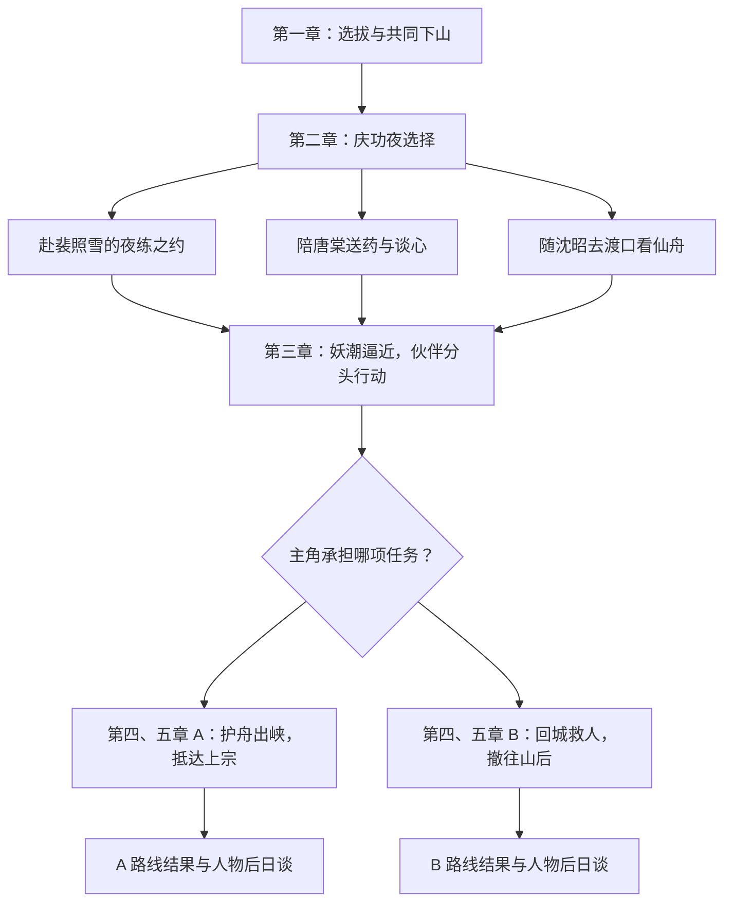

# 《见仙》全局故事与路线候选

日期：2026-11-22。

状态：用于讨论整部影游结构的候选，未采用。创作者对吸引力与卖点提出疑问，本轮建议先验证立题，不继续扩写此稿。人物姓名、人数、灾变背景、章数与结局均可调整。画面全 AI，眼睛保留既定金手指，不要求承担核心操作系统。

## 一、推荐的路线结构

共同主线建立人物、成长与主要矛盾；其间让玩家进入不同人物的短段落。后段明确选择行动目标，进入两套不同的终章。此前的相处和承诺继续影响谁怎样参与，以及最终关系。

本候选采用五章结构：前三章有共同的大事件，第四、五章按行动目标分为两套。恋爱关系不直接决定主角必须走哪条任务路线。

## 二、全局梗概

边地小城的一批成年同窗，即将结束学馆修业。上宗的接引舟数日后抵达，优胜者有机会离乡深造。主角与兄弟周野已经进入最后选拔；几位女同窗也各自准备着未来，有人急于证明实力，有人想远行，也有人还舍不得城中牵挂的人。

一次共同下山的任务中，大家遇到本不该出现在这里的妖兽，合力救下返城百姓。回城后的庆功与相处，让玩家真正进入其中几人的生活。随后，异常发展成提前到来的妖潮，原本接走优秀弟子的仙舟开始搭载百姓。

城外的师长正在阻敌，仙舟必须在河谷被截断前出发，另有伤员和同窗来不及登舟。伙伴们先后作出自己的决定。主角也必须决定亲自护送船上的人出峡，还是返回城中，帮助留下的人撤往山后避难地。

选择护舟，后半部经历船上争执、峡口遭袭与抵达上宗；选择回城，则经历逆行救人、与留守者合作及最后的撤离战。两条路线都完成本部的救援目标，并让主角从跟随别人行动的新人成长为能承担一项职责的修士。

尾声中，同窗已经走上不同道路。有人去上宗，有人留下学医，有人开始远游。谁与你相恋、谁与你守着一个约定、谁渐渐疏远，由之前的相处和选择决定。这次离别是本部故事的收束，后续故事可以从重逢继续。

妖潮的成因、是否连接仙躯世界的更大异常仍待选择。本部先完整解决人物的当前危机，不要求玩家补完其他路线才理解结尾。

## 三、主要人物暂设

| 人物 | 初见印象与自己的愿望 | 在共同事件中的作用 |
| --- | --- | --- |
| 主角 | 普通家庭出身，勤学、好奇，希望获得更好的修行机会 | 玩家决定他的态度、行动与亲疏；金手指在关键情节提供优势 |
| 裴照雪 | 凌厉、高傲的世家女同窗，希望成绩被认可，也想摆脱家族安排 | 起初是竞争者，后来面临宗门命令、前途与自身判断的冲突 |
| 唐棠 | 温柔熟悉，却对重要事情十分坚持；想进外地医馆学习 | 既想远行，又放不下尚未撤走的病人，倾向留在城中救人 |
| 沈昭 | 明亮洒脱，盼望亲眼看遍山海 | 最期待登舟，也愿意为船上的陌生人承担责任 |
| 周野 | 剑术好、爱谈赚钱，希望家人过得更好 | 与主角有共同经历，灾变中先照顾家人；能支持，也会与主角争执 |

角色在未选择的支线之外也继续生活和行动。进入某位女主的片段不会自动令其他人物消失，更不等于立即确定恋爱关系。

## 四、整部路线图

图只显示会改变一段以上剧情的选择。普通回应、斗法中的短决定和结局内部的小分支，写分场时再补，不把所有按钮塞入总图。

## 五、玩家一次通关实际经历什么

### 第一章：我们以为，赢了就能一起走

直接从主角与周野的一场合作比试进入故事，接着完成共同的下山任务。裴照雪在竞争与战斗中出现，唐棠照料伤者，沈昭主动接近需要帮助的旅人。通过行动认识各人，不先轮流介绍背景。

任务中有一次真正的协作打怪，眼睛帮助主角抓住机会，玩家作关键行动选择即可。人物获胜、挣到报酬或得到认可，给出开局的成长与收获。异常妖兽留下一个简单的危险征兆。

### 第二章：庆功之后，各人有各人的事

先有一场共同吃饭、谈论去处的戏。晚上从三次邀请中选一次；每条是两场连续的专属相处，随后进入共同的下一天。

| 当晚的选择 | 接着播放的两场戏 | 这次经历以后怎样回来 |
| --- | --- | --- |
| 接受裴照雪邀约 | 私下比剑；收剑后谈到家族为她安排的道路 | 后来她被要求提前离城，玩家可以提起当晚她说过的愿望，进入一段坦诚争论 |
| 陪唐棠送药 | 街巷中轻松相处；在医馆得知她已收到外地邀请，却迟迟没启程 | 留城路线里可以一起决定何时结束等待、带病人撤离；护舟路线里可明确约定以后重逢 |
| 随沈昭去渡口 | 偷闲登上尚未启航的仙舟；共同在地图上选择想去的地方 | 护舟路线末尾，她会拿出那张地图；未经历此段则是另一场有关未来的谈话 |

上述关系回调取决于当前场景是否适合发生，不保证一段甜蜜相处就能让角色接受所有请求。

### 第三章：送别突然变成撤离

异常妖兽的警讯成为现实。师长在城外阻敌，接引舟开始接纳百姓。主角可以选择先帮渡口安排登舟，或者先协助城内转移伤者，体验不同的一段短任务，随后都在渡口见面。

这次短分支记录做过的事，例如是否将医馆的急救药提前送上船、是否与留守同窗约定了山后集合地。没做的工作可以由其他人物承担，但未必达到同样结果。

正式分线之前，角色表达自己的决定：沈昭护船，唐棠回城，周野要先安置家人，裴照雪面对师门安排。玩家得到清楚的目标说明，再选主角去哪边。

### 第四、五章 A：护舟远行

第四章从船舱和甲板展开。船上有同窗、百姓和上宗人员，空间与时间紧张，人物因不同顾虑争执。玩家决定先安顿谁、把掌握的信息告诉谁，并承担护舟中的具体职责。

第五章发生峡口袭击。师长负责抵挡强敌与操舟，主角和同窗保护甲板、救下落水者或阻止妖兽破坏船体。通过几次重要行动和合作完成高潮，不要求低阶主角突然单挑整个妖潮。

主要结果是船抵达上宗，主角凭经历获得继续修行的机会。可以有保全较好和付出较大损失的两个结果版本，随后收到故乡消息。不是选择远行就自动判留城者死亡。

### 第四、五章 B：回城守护

第四章从逆行返回街巷开始。玩家亲历与唐棠救人、寻找被困同窗、决定何时撤离医馆的故事，与 A 线的地点、矛盾和相处完全不同。

第五章是配合师长守住最后撤离通道。主角承担一个有限但决定成败的任务，与留守伙伴打完最后一场合作战，带人撤往山后避难地。

主要结果是错过这一趟升宗机会，但得到当地师长认可与后续传承。结果可以是人员较完整地撤离，或为了救人放弃学馆的重要物资。后记收到远行同窗的来信，未来仍有求学、远游与重逢的可能。

## 六、恋爱、兄弟关系与主线结局怎样结合

主要行动路线由玩家当场明确选择。关系收束再结合相处、承诺是否兑现和最终表达，不采用一个隐藏好感数值自动替玩家决定整个人生方向。

| 一次通关的经历组合 | 可以得到的关系收束 |
| --- | --- |
| 与沈昭深入相处，选择护舟，最后接受她的同行邀请 | 两人在上宗外谈论下一段旅途，可以确立恋爱关系 |
| 与唐棠深入相处，选择护舟，并在分开前诚实约定 | 带着约定分别，尾声以她的来信收束；不因没选留城就自动失去感情 |
| 与裴照雪建立信任，选择留城 | 她可以支持你的选择，但仍按自己的安排去上宗；以相约再比一场的分别收束 |
| 周野家人得到安置、主角履行此前约定 | 兄弟在各自路线中继续合作或在尾声约定重逢 |

这些是候选结果，不是完整的结局触发公式。正式写作还要明确关系的发展过程、失败结果和不同片段所需的前置条件，避免只在结尾突然宣布恋爱或绝交。

人物收束只制作少数有情感分量的版本，不能把两条主线与所有角色状态机械相乘。具体组合应由剧本选择。

## 七、共同剧情与分线的制作范围

只按主体章节看，是三章共同内容，加 A、B 两条路线各两章，共七个章节单元；玩家一次走五章。人物短分支和后日谈另算，这不是片长、成本或工期估算。

前段的短分支经过不同相处后回到共同事件；后段两条路线有各自的冲突和高潮。差异要从人物的行动、场景与结果体现，不能只给同一段影片换台词。

一次通关完整结束一条经历，另一条供自愿重玩。章节回看属于播放器和存档功能，世界本身不需要重生或轮回。

## 八、还需要决定什么

首先评议的是这件共同主事件是否值得看，以及“离乡与留下”能否承载想要的爽感、成长和感情。若主事件不满意，可以换成其他冲突，保留共同章节、人物短线与后段长路线的结构。

选定主事件后，再把每章拆成场景和选择节点：每个节点写清上一场发生了什么、屏幕上给玩家哪两个选择、选后具体播放哪场戏、以后是否再用到这次选择。先完成可阅读的整条路线，再考虑额外小游戏与数值系统。

## 九、本轮吸引力复核

创作者反馈：不知道怎样审核设计，感觉部分内容不够吸引人，卖点不清楚。以下是作者对当前候选的判断，不是受众研究或市场验证。

### 当前稿的三个不足

1. 选拔、庆功、妖潮和救援提供了事件顺序，但还没有一个让人迫切想知道答案的核心问题。
2. 高傲、温柔和向往远行主要还是性格标签；角色缺少一场足以让玩家喜欢、好奇或在意的具体行为。
3. 前段铺垫竞争、心动和个人前途，后段分线主要由救援任务决定。两条路线的地点与任务不同，人物自己的欲望却还没有充分推动选择。

因此保留本稿作为分支组织的结构示例。是否值得成为正式故事，要先通过更短的立题与场面验证。

### 三种吸引力方向，只作比较

这些是供判断兴趣的关键场面草案，不是确定的新世界规则或完整开篇。选中后仍要检查动机和因果，不能只保留悬念而不准备可信的答案。

**A：靠本事赢得强者认可。** 主角试剑获胜，却因争议被要求重赛。原本与主角竞争的高傲女修押上自己的推荐资格为他担保；兄弟也把攒下的盘缠押在这一战。可期待的是主角如何赢、为何她肯站出来，以及胜负之后的人情与关系。需要检验它是否过于套路，女修的支持是否有足够前因。

**B：公开亲密、私下交易的修仙恋爱。** 高冷同窗提出假扮道侣：她需要摆脱家族安排，主角需要她的担保争取上宗机会。公开场合两人亲密，私下约定互不干涉；一次意外迫使主角判断，她为自己冒险还算不算演戏。需要补齐假扮关系为何能解决问题、为何选主角及双方独立目标，不能用契约设定跳过感情发展。

**C：曾经最亲近的人，后来站在两边。** 宗门公布的叛徒画像是主角的兄弟，追捕他的领队是主角在意的女同窗。两人分别讲述了不同的经过，又都请求主角给对方留一条退路。可期待的是同窗为何走到这里，以及自己如何参与；需要先用共同经历建立感情，不能只靠重逢的姿态制造分量。

### 创作者如何给反馈

先回答三个直觉问题即可：哪一个具体场面想继续看；对哪个人的行为最有兴趣；第一处选择是否真想知道两种结果。都不想看也是有效结果，不需要给专业术语或完整修改方案。

作者负责先检查人物动机、事件因果、成长回报、选择后果与制作规模，并主动写明薄弱之处。不要把结构完整、文件齐全或分支数量当成吸引力的证据。

### 建议的后续验证

从简短立题中找到一个有兴趣的方向后，先写一场完整开场和两个真实选择，确认想追看、想亲自决定，再展开全局。随后用临时配音、分镜和占位剪辑试节奏；面向实际目标玩家收集反应，再投入正式 AI 画面。

创作者个人喜欢只通过了第一道判断，尚不能证明市场需求。本轮没有执行外部受众测试，也没有选定 A、B 或 C。
