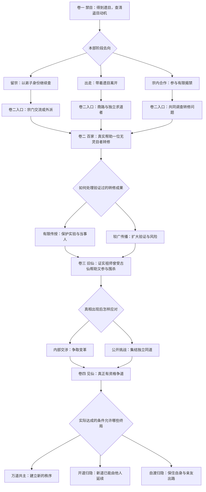
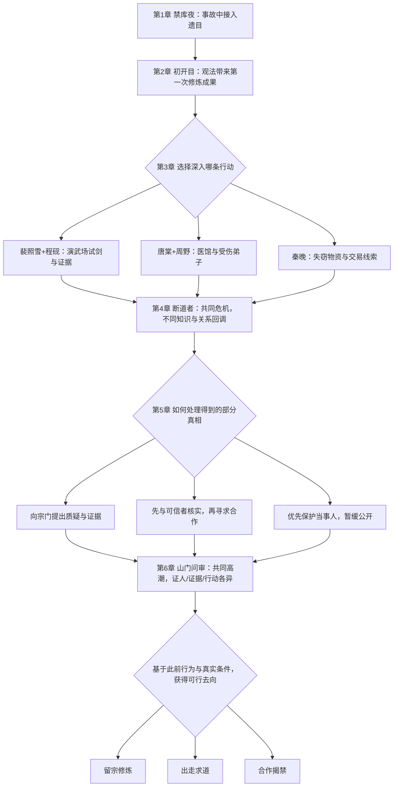

# 《见仙》全局分支树与人物路线 v0.2

**状态：用于审核的叙事结构提案，不是剧情定稿。** 严格保留《修炼体系》《灵目渊源》已确认规则；窃道者、道基重构、宗门祖师曾参与围杀的世界底稿不改动。角色姓名、六章划分、行动和分支条件都是工作假设。采用四卷长线作为故事架构，不承诺四款游戏；首个 Steam 产品仅建议覆盖第一卷。

## 一、先解释：完整分支树不等于全排列

必须同时保存三种图表：
- **世界与主线图：**每卷必然发生的共同事件及长线命运选择。
- **可玩事件图：**第一部每个重要选择、回流点与阶段结局。
- **状态／人物图：**被跳过的人物仍独立行动；玩家拥有何种知识、承担过什么、与谁有过亲历，将决定后续场面和可用行动。

节点分为「共通剧情」「局部分支」「状态回流」「重要分线」。已经确认的事实不因不同路线变化，改变的是主角获得信息、行动、人物反应与命运。

## 二、四卷宏观命运树（故事层）

注意：卷一的三种结局不是三条完全无关的第二卷。到卷二仍有共同的“无灵目者能否转修”事件，但**身份、风险、信息来源、同行者和初次见面的关系不同**，不能一句对白就把之前的出走抹掉。卷三的行动不自动决定卷四结局，只改变可建立的联盟、对立面和代价。

## 三、第一部《禁目》六章可玩节点树

这里的第3章是“选择重点参与”，而不是其他人停止生活。主角不参与唐棠的夜间工作，她仍救治患者；不参与秦晚的追查，秦晚仍要处理损失与交易；玩家失去的是亲身见证、共享秘密、取得专属证据与相应后果。

特别注意：**主角接入遗目是全作成立的共同前提。** 如果无论选择什么都必须接入，就不要设置假的“是否接入”生死选项；当夜应让选择影响救谁、留下何种痕迹、谁看到了什么。融合原理仍需另外完成机制设计。

## 四、六章的选择和兑现账本（工作示例）

| 节点 | 玩家能选择什么 | 本章独有体验 | 后续何处兑现 |
| --- | --- | --- | --- |
| 第1章：禁库夜 | 优先带伤员离开或冒险保留可辨识线索；均不能不接触遗目 | 谁见证主角的行动、留下什么物证 | 第5章证据链、第6章证言与责任 |
| 第2章：初开目 | 对一位可信者说出部分异常，或自己试练 | 训练与关系细节不同 | 第3章疑问、第5章知情范围 |
| 第3章：演武线 | 与裴试剑、程砚核验演武记录 | 主角技艺精进；裴发现无法解释的观察；程要求合理证据 | 第6章由裴提供技术证词；程判断是否合乎宗规 |
| 第3章：医馆线 | 与唐、周保护并询问断道者 | 受伤者视角、唐的医疗原则、周的护送风险 | 第4章风险判断、第6章是否有经允许的证词 |
| 第3章：交易线 | 与秦核对禁库物资与流转 | 非武力调查、秦的交易代价和一段亲密共事 | 第5章失窃动机证据、第6章能否证明幕后行动 |
| 第4章：断道者 | 优先保障伤者稳定或抢先核查可消失的证据 | 救治与调查孰先的真冲突 | 第6章伤者状态、证据强度、同伴的立场 |
| 第5章：部分真相 | 公开质疑／内部核验／保护当事人 | 可结交、失去的支持者不同 | 第6章参与问审的人和可以提出的要求不同 |
| 第6章：问审 | 根据已掌握信息与承诺，争取合理去向 | 留宗、离开或合作调查的完整阶段结果 | 卷二入口不同，并保留长期人际与制度后果 |

不能设成“选谁陪伴，便神奇地自动获得唯一解”。必要的事实可由别的角色通过自己的行动得到；玩家多拿的是独特的解释、证据呈现方式、信任与回报。第5章不能直接证明全部古仙史实，第6章不应只靠嘴炮解决盗目危机；主角须有可展示的修行成果和切实行动。

## 五、女主和兄弟怎样跨卷推进（同一个故事里的六条人生）

| 人物 | 卷一（共同起点） | 卷二（分开走路） | 卷三（秘密揭露） | 卷四（自己也有终点） |
| --- | --- | --- | --- | --- |
| **裴照雪** | 初期剑术压制主角；试剑后开始认可；面对师门调查不能轻易偏袒 | 进入更完整剑道传承，与主角分别再重逢 | 确认祖师参与围杀，思考守护师门与拒绝旧错能否并存 | 可能改革宗门、随主角同行或成为独立剑道强者；亲密不等于丧失立场 |
| **唐棠** | 医治断道者，要求安全可核验而非天才男主一眼治好 | 独立研究转修风险，可能主导无灵目者的首次验证 | 面对公开方法带来的危险，要求控制实验与知情同意 | 可以留下医道传承；她是否爱主角不决定其医修成就 |
| **秦晚** | 与禁库材料、交易相关，主角以真实合作取得信任 | 商路与符器网络让新法传播具有现实渠道和代价 | 选择公开运输线索，还是保护依赖网络的人 | 能成为独立势力与主角的伴侣、盟友或商业对手 |
| **周野** | 一起承担风险，重视家人的现实处境 | 走自己的护商道路，后来掌握人员与物资流动 | 有自己的底线；不应因“兄弟情”自动卷入无条件赴死 | 可以带人离开争斗、守护通路，或拒绝参与政治争道 |
| **程砚** | 相信宗规与证据，既质疑主角也避免冤案 | 用传统传承深入修行，验证所谓自由新法有没有真实可靠性 | 不因揭露祖师旧错就瞬间否定全宗，可能继续留宗改革 | 可以与主角竞争、交手或共同解决旧规；不必突然黑化 |

三位女主的情感发展都需要“吸引—共同经历—现实分歧—关系回应”；每卷有独立事件，不是只有主角约她才有命运。周野与程砚不是背景助手：周对行动成本提出现实反对，程对规则与证据提出原则性反对，并都有能力改变最终局势。

## 六、全局条件不是简单好感值

| 状态组 | 具体记录的事件事实 | 后续用途 |
| --- | --- | --- |
| 证据与知情 | 谁亲眼看见、哪份账册/病历可合法使用、谁知道灵目 | 第5/6章调查、卷三旧史的可信程度 |
| 亲历与承诺 | 跟谁完成任务、答应过保护什么、后来有没有兑现 | 关系亲密、背离、远行或再见的具体台词及行动 |
| 修炼与传授 | 自身学会什么、哪些方法由无灵目者验证、有没有安全记录 | 卷二转修案、卷四“开道归隐”能否成立 |
| 现实支持 | 交易网络、证人、同道、宗门内部保护或约束 | 卷一去向、卷三联盟与卷四世界结局 |

一条人物路线不应被单一数值锁死。假设主角曾答应唐棠不得拿伤者冒险，后来却背着她试验：即使他送再多礼物，这件事情仍然需要被当面解释和承担后果。玩家可以修复关系，但不应抹掉已发生的事。

### 特别核验：跨卷接续

- **卷一留宗：**卷二作为交流或外派成员接触他派，不等于永远呆在禁库。
- **卷一出走：**卷二从周野或秦晚的外部路线接触转修案，旧宗门仍可派人追查。
- **卷一合作揭禁：**卷二以受限定的研究身份参与同类案例，受到宗门内部监督与争论。
- 这三种身份都能遇到一个需要真实转修的案例，但资源、旁人的态度、风险及人物相逢的方式不同。**不能把三种结果用同一句“大家又汇合了”抹平。**

## 七、怎么审核这套分支是否好玩

先检验两条不同的连续通关路径，不只看一个孤立场面。

**路径甲：**卷一第3章走裴照雪／程砚线；第5章选择内部核验；第6章争取留宗。玩家体验的是剑术成长、宗规质询、在珍视的宗门里保住位置，以及裴对他既亲近又怀疑。

**路径乙：**卷一第3章走唐棠／周野线；第5章优先保护伤者；第6章出走。玩家体验的是伤者命运、兄弟现实风险、与唐建立医修共识，以及失去宗门支持后怎样继续修炼。

评判标准不是“两个路线换了几句对白”，而是能否指出不同的**画面、人物行动、主角成长与后来结果**。如果两条路线在第6章除一句台词外没有不同，就删除或重写分支；如果某人不被选择就从此消失，也要重写。

**本稿尚不是逐镜头、逐台词的可生产完整节点图。** 它是覆盖四卷命运、卷一六章主要决策、五位配角长线轨迹、分支状态与收束条件的**可审核全局骨架**。下一步应为每一个重要节点补“进入条件—事件—选择—即时结果—跨章回调—影视片段成本”，再选两条完整路线写成剧本并验证体验。
