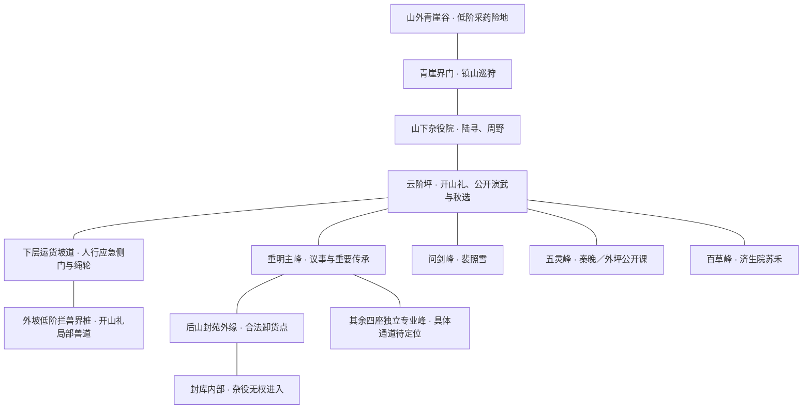

# 《见仙》重明宗：七峰一主峰与三堂体系

**已确认：**宗门正式名称为**重明宗**；三位重点首座分别是**问剑峰顾停舟、五灵峰贺明筠、百草峰孟怀真**。**按本次创作方向采用：**七条专业分脉，五行脉替代笼统的术脉，丹脉吸收医修培养，**不单设体脉**；每脉有独立山峰，另设重明主峰。其余峰名、人数和具体资源配额仍是可调整的工作参数，不改变[修炼体系](修炼体系.md)的既定修炼规则。

## 一、基本组织：一座主峰、七座专业峰、三堂

**重明宗**是一方有历史和实力、但并非天下第一的正道大宗。山门在一片连绵的灵山中，主峰主持宗门事务，七座各有传承与专业资源的山峰环绕。

**宗门、专业分脉、职责和高阶道统不是同一个层级：**
- **宗门：重明宗**，实际收徒、师承、修炼、任务与安全的共同体。
- **七脉：剑、五行、符、阵、丹、器、御兽**，按主要技艺组织师徒和资源，不是七条独立的成仙大道。
- **三堂：庶务、戒律、镇山**，对全宗处理事务、执法及护山；三堂长老与七峰首座分工并行。
- **道统：**围绕一条完整根本仙路形成的传承与资源关系，宗门可为其主要载体。不同峰可共学本宗基础根本法，剑术、火术、医术不是七种互斥根本功法。

## 二、重明宗八峰（主峰＋七脉独立山峰）

| 山峰 | 师承／岗位 | 独立资源、地貌和教学 | 第一部的用途 |
| --- | --- | --- | --- |
| **重明峰（主峰）** | 宗主；三堂决策和部分执事办公 | 主殿、藏经楼、议事殿、护山阵中枢；高阶禁区入口须分级把守 | 宗门代表性远景、重大任务、公议及后山封苑伏笔 |
| **问剑峰（剑脉）** | **首座顾停舟（已定）** | 听剑崖、试剑台、剑谱阁、剑器养护与剑术师承 | 裴照雪的师门；剑会和问剑；陆寻以后可获得正当试剑机会 |
| **五灵峰（五行脉）** | **首座贺明筠（已定）** | 五行练场，火、水、金、木、土基础与精细直施术法、灵力控制课 | **内门弟子秦晚**精练火行术法、开山礼收火护工役、兼学朱箓峰符箓 |
| **朱箓峰（符脉）** | 首座待定 | 灵符阁、符室、符纸和灵墨仓、触发与封存检验 | 秦晚兼学低阶符箓；引兽符残灰的专业背景 |
| **天枢峰（阵脉）** | 首座待定 | 试阵场、阵盘和阵基、供能资源、护山阵研究 | 宗门防御与封苑事故中的阵法支持，不新增万能阵师 |
| **百草峰（丹脉，含医修）** | **首座孟怀真（已定）** | 丹霞院、丹炉和灵药田；济生院、医案与伤病康复资源 | 苏禾是济生院定向学徒；周野伤病和丹药资源冲突 |
| **铸星峰（器脉）** | 首座待定 | 炼器炉、矿材、剑器修复、机关与器件制作 | 周野可申请器坊工役；剑脉、阵脉依赖这里的器物 |
| **万兽峰（御兽脉）** | 首座待定 | 兽舍、灵兽谷地、驯养训练、兽食与兽医 | 灵兽运输和兽性知识；青崖谷妖兽不能被符咒写成完全无意志的傀儡 |

**五灵脉为什么不是统管所有术法？** 五灵峰重点研究直接调动金木水火土属性灵力、施法稳定性与控场；剑的攻防技艺归问剑峰，符箓封存归朱箓峰，阵基联动归天枢峰，丹医归百草峰，器具制造归铸星峰。**所有修士都可以学基础五行术法，不代表都必须拜五灵峰。**

**丹医合一但仍分科：**百草峰只有一位峰主**孟怀真**，峰内设**丹霞院**（炼丹、炮制、丹方）和**济生院**（医修、辨药、诊伤、康复），各有资深教习主持日常；济生院学徒可以主攻医术，不强制同时成为高级炼丹师。医案、救治与制丹共用部分药田，依任务分摊资源，避免另设医脉首座。

**不设独立体脉：**锻体、耐力、承伤和恢复属于全宗公共基础课程；愿意长期主攻肉身近战者仍可以在其他脉寻找合适导师或专门研修，但目前不单列峰主、学籍及拨款。**取消体脉机构不等于废除体修能力**。

## 三、弟子与任职人数：保留2,400人工作规模

| 在籍人员 | 人数 | 口径 |
| --- | ---: | --- |
| **杂役** | **1,500** | 山下杂役院工作，学基础吐纳，可报名外门；部分进入专业学徒预修 |
| **外门弟子** | **700** | 有正式师承资源和主修方向，可申请兼修 |
| **内门弟子** | **120** | 有具体师长和深度培养，**包含12位核心真传，不另加** |
| **专职任职修士** | **80** | 宗主1＋七峰首座7＋三堂长老3＋执事18＋教习／医修／护山骨干51 |
| **合计** | **2,400** | 不含散修访客、凡俗商队和灵兽 |

**现在是10名实权长老（7峰主＋3堂主），不是之前的12名。** 核心真传仍为12人，但不必按七峰平均分配；峰主职位是教学管理职务，不是新增修为境界。

### 七峰的外门和内门人数建议

| 山峰 | 外门 | 内门（含本峰真传） |
| --- | ---: | ---: |
| 问剑峰 | 200 | 38 |
| 五灵峰 | 200 | 32 |
| 朱箓峰 | 80 | 12 |
| 天枢峰 | 45 | 9 |
| 百草峰（丹医合计） | 85 | 15 |
| 铸星峰 | 60 | 9 |
| 万兽峰 | 30 | 5 |
| **合计** | **700** | **120** |

**杂役学徒不计入**外门700和内门120；苏禾仍是杂役，只获得百草峰济生院的定向学徒机会。**秦晚已经是五灵峰内门弟子**，计入该峰内门32人，不参加外门选拔。

## 四、三堂与七峰如何协作

| 公共事务堂 | 负责什么 | 与七峰的边界 |
| --- | --- | --- |
| **庶务堂** | 登记、功点、月例、任务许可与验收，外门招录组织 | 能组织公开外门考核，但专业评估由各峰首座及教习进行；严承只能领取授权的采药领队任务 |
| **戒律堂** | 受理投诉、保全现场、核验证据、违规调查和裁处 | 峰主不能因为偏爱弟子直接判其无罪或定罪；青崖谷案由戒律堂负责 |
| **镇山堂** | 山门巡逻、封禁边界、护山应急、核心禁地外围安全 | 可以按制度借调峰门弟子轮值，**裴照雪仍属问剑峰，临时带镇山堂巡守队** |

宗主召集七峰首座和三堂长老商议重大跨峰资源；**每峰有各自预算、专业材料仓与入脉考评**，庶务堂负责账目、跨峰公共资源协调。十八位执事建议分配为三堂各3名（共9）和七峰合计9名，负责普通行政与教务；另外51名专职人员承担授课、医护和守山骨干工作。

**常见协作：**问剑峰请铸星峰修剑；五灵峰弟子去朱箓峰学用符与制符；阵脉与符、器两脉共同维护护山阵；百草峰济生院治疗伤者，丹霞院提供适合的丹药。

## 五、身份分层与外门入脉

| 身份 | 资源与专业归属 | 剧情上的真实变化 |
| --- | --- | --- |
| **杂役** | 基础吐纳、劳作功点，可旁听公开讲习或参加专业预修 | 陆寻缺资源、苏禾为济生院学徒；**秦晚不属于这一层** |
| **外门** | 固定月例、规定课时和正式主修峰学籍，可兼修低阶其他技艺 | 入外门后陆寻第一次真正可以选师承，生活待遇随之变化 |
| **内门** | 固定师长、进阶根本功法、专业传承及更高资源 | 具备更深培养和历练机会，不是每人自动晋真传 |
| **核心真传** | 内门中12位重点培养者，有更深传承，也承担更多事务 | 裴照雪既受顾停舟亲传，又须轮值镇山巡狩，资源和责任同时存在 |

**外门选拔建议：**每年从杂役及符合资格的山外报名者中录取约80位外门，所有候选先通过基础吐纳控制与安全条件；**内门弟子不参加这场选拔**；合格候选再分剑／五行等斗法方向和符／阵／丹／器／御兽等专业考评。**百草峰的医修候选可以靠真实诊药和康复基础取得专业资格，不必被迫参加剑术对打。** 具体跨专业名额、严承与陆寻如何在同一实战组相遇，仍需在剧情中提前交代。

**主修不绑感情：**和裴照雪亲近，不等于一定入问剑峰；与苏禾亲近，不等于必须当丹师。修行是学习资源选择，关系是人物选择。

## 六、六位故事人物现在住在哪儿、和谁学？

| 人物 | 开局登记与所在 | 实际师承／职务 | 第一部的合理接触 |
| --- | --- | --- | --- |
| **陆寻** | 山下杂役院，**杂役**，炼气初期（暂定） | 未正式入峰，只有基础课和自练剑术 | 云阶坪工作与外门考核；晋升后申请正式培养 |
| **周野** | 山下杂役院，**杂役** | 山路运输、绳轮和器具经验；可能争取铸星峰安全工役 | 青崖谷互救、后山夜袭与未来岗位 |
| **裴照雪** | **问剑峰核心真传**，筑基初期（暂定） | **顾停舟亲传**；镇山堂借调，轮值封禁巡守队长 | 青崖谷一剑封山，日后在问剑峰试剑 |
| **秦晚** | **五灵峰内门弟子**，建议炼气后期（待核） | 贺明筠指导火术，兼学朱箓峰符箓 | 雨中内门公开斗法、公开讲习和真实共同任务；**不争外门名额** |
| **苏禾** | 百草峰济生院**杂役学徒**，炼气初期（暂定） | 济生院医修带教，争取正式专业资格 | 医修学习、疗伤与康复 |
| **严承（暂名）** | **杂役、外门选拔候选者**，炼气中期（暂定） | 家学护具较好，临时采药队权力由庶务堂授权 | 与陆寻争夺外门资格，青崖谷犯下实际恶行 |

## 七、三位确定首座的性格与代表性矛盾

**顾停舟｜问剑峰首座。** 外表平和、实战判断极快。认可裴照雪巡狩守人，也提醒她带伤硬练会毁掉未来剑途；不因陆寻曾获裴救命就直接将其收为亲传。戏剧功能：**剑脉的高标准和师徒牵挂**。

**贺明筠｜五灵峰首座。** 重视术法创新，但更看重在不同环境下可重复的控制精度。秦晚雨中火术惊艳，她仍要求在其他场地做到同样的稳定与收放。戏剧功能：**秦晚必须靠长期训练而非一次胜利证明自己**。

**孟怀真｜百草峰首座。** 同时统筹炼丹、用药与医修培养，严谨惜药但遇生死急症先救人。教苏禾先弄明白病理、药性与权限边界，不让她用善心替代医术。戏剧功能：**苏禾拥有自己的专业成长，而不仅是陆寻的药庐朋友**。

其余四峰首座的姓名和关键人物戏暂不创造；待各峰真正进入故事时再定。

## 八、地理与影片制作上的“七峰一主峰”

**主峰重明峰**在山势中心，七峰环绕分布；山下设**役院**，山腰设**云阶坪**（公共演武与开放讲习），不把这两个公共场所算作新的专业峰。

第一部主要反复拍摄：役院、云阶坪、问剑峰、五灵峰、百草峰、主峰与后山封苑。朱箓峰、天枢峰、铸星峰、万兽峰可以先以远景、课程或少量任务亮相，后续剧情再深入。**七峰独立，不等于每一集必须拍全七峰。**

山外**青崖谷**是低阶采集地、受镇山堂巡守；主峰背后**封苑／禁库**是宗门禁地，两处危险地点不能合并。封苑外围合法卸货点可以发生外敌袭击的波及事件，但杂役无权进入核心禁库。

## 九、道统与修行技艺的边界

重明宗可传承一条主要根本修炼道路，但还没有给它强行定名。**七峰负责剑、五行直接施法、符、阵、丹医、器、御兽等技艺；道统负责跨境界延续的根本法及师承资源**。七峰首座不是七位道主，五灵峰也不包办全宗所有法术；每个弟子都可以合法学习其根本功法允许的跨峰通用技艺。

已确认的古仙、道主和道基重构历史不因七峰合并而改写。宗门是否由当年背弃古仙的新道主创建、遗目为何封存此宗，都要有故事因果才锁定。

## 十、仍可调整的细节

重明宗及顾停舟、贺明筠、孟怀真三人姓名**已经确认**；七峰峰名、人数配比、各峰入门考核的细节、其他四首座姓名、宗主修为和封库机制仍是待打磨参数。**下一步优先写可拍的七峰师徒事件与一套不强制全员上擂台的外门选拔规则**，不要重新扩展一套复杂组织体系。

## 十一、地界图与大世界地图规划（创作工作图）

**先画重明宗地界关系，后画大世界。** 当前草图是通行与镜头关系图，**不按比例、不标具体方位或分钟数**，不要当作已定地理坐标或正式美术图。

这里把**朱箓峰、天枢峰、铸星峰、万兽峰**合在一个图节点，仅为了避免提前虚构它们的相对方位；**实际仍是四座独立山峰**。

**必须固定的场景通行逻辑：**杂役从山下役院可按规定走公共山道到云阶坪，能看内门公开斗法、参加公开讲习，却不能擅闯五灵峰内院；陆寻兄弟在青崖谷遇险后通过界门被镇山巡守接应并送济生院；后山封苑外围卸货点可合法安排杂役差事，禁库内部必须有分级封禁，夜袭如何外溢仍待事件逻辑证明。

**大世界暂分三级深化：**

| 范围 | 当前地图内容 | 什么时候细化 |
| --- | --- | --- |
| 重明宗地界 | 主峰、七峰、杂役院、云阶坪、青崖谷、封苑及出入口 | **现在需要**，服务分镜与场景生成 |
| 宗门周边 | 坊市、凡人城镇、山外历练地区、相邻宗门的预留区域；不急于命名 | 第一部开始正式出山时 |
| 整个修仙世界 | 大陆山川、成熟道统与道主势力、古仙旧地等 | 后续主要矛盾与旅行路线成形后 |

地图后续需要写清**唯一场景ID、通行权限、场景地貌、主要路线、镜头复用点**；现在不凭空设定各峰具体经纬度、里程或所有国家、祖庭。

**第一幕地点边界已定：**云阶坪上层演法台及观礼护幕与下层杂役运货坡道是不同安全区域；外坡低阶界桩连接山外兽道，不属于主峰核心护山大阵。坡道设可由平时工役操作的应急侧闸、绳轮与备用运货板。开山礼角兽闯入属于局部事故，镇山堂随后接管，**不是青崖谷断桥或封苑夜袭的同一地点**。具体剖面、道路坡度和妖兽正式名称需分镜核验。
