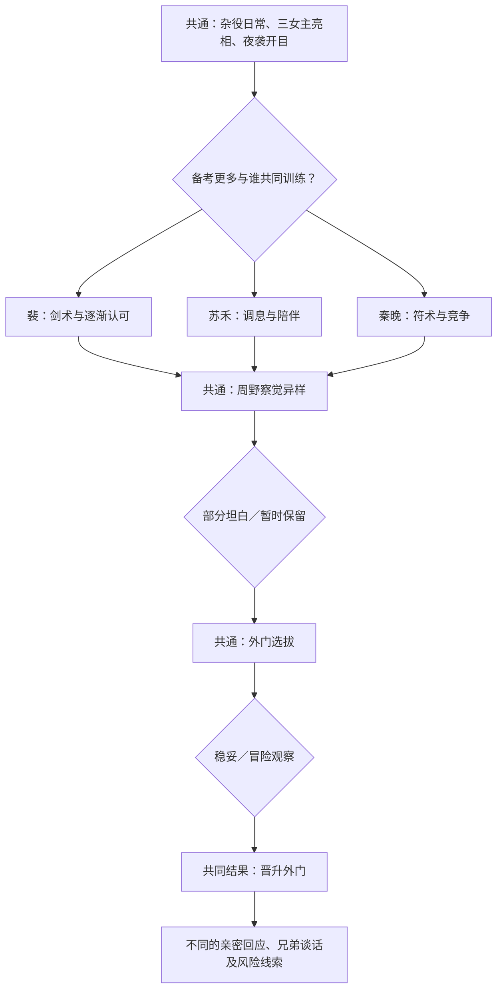

# 《见仙·山门》故事与互动蓝图 v0.3

**状态：首部剧情工作方案，尚未定稿。** 已确认的修炼规则、古仙渊源、五名核心人物见仓库对应文件；本稿只规定当前建议采用的故事走向与互动后果。

## 一、故事定位与结局

**体验：**底层杂役求仙、三位女修的不同心动、与周野一起吃苦、意外获得灵目后逐渐变强。

**首部目标：**陆寻获得外门资格。**首部结局：**夜袭被宗门击退，周野生还，陆寻靠真正练成的本领通过外门选拔，搬出杂役院。**长线悬念：**未知来袭者为何争夺封存古物、遗目与陆寻的联系意味着什么。

主角不是破案者：禁库、封阵与追击由宗门负责，陆寻作为杂役只需应对伤病、修炼和秘密。

## 二、默认通关故事

| 段落 | 主要故事 | 对玩家的回报 |
| --- | --- | --- |
| **1. 山门下** | 陆寻和周野搬运演武器具、计算工分；陆寻为外门考核攒修炼材料，夜里靠基础讲义练功。周野嘴上精打细算，暗中帮他补足伤药。 | 立刻看懂杂役与外门的待遇差距、主角目标及兄弟情 |
| **2. 三位女修** | **苏禾**在药圃认识他们很久，边替周野处理伤口边斗嘴；**秦晚**是同届符术考核的明艳对手，主动和陆寻较量；**裴照雪**是外门出色剑修，陆寻模仿其剑招时得到一次简短指点。 | 前段认识三种有吸引力、年龄接近、都与修炼相连的姑娘；不立刻锁定恋爱 |
| **3. 后山差事** | 为补选拔费用，周野接一趟后山外围高工分搬运；陆寻见他带伤，收工后赶来帮忙。两人只有外围卸货权限。 | 困顿日常推动主事件，而不是凭巧合进入禁库 |
| **4. 夜袭开目** | 不明修士突袭封库，遭守卫拦截并沿外围山道撤退；追击冲突波及卸货台。周野受困，陆寻冒险救他。禁物封存同时受损，陆寻短暂接触其逸出的异常灵性，首次看见实际灵力运行，借此避开一次危险，随后昏迷。宗门增援击退来袭者。 | 高紧张度危机、兄弟关系、金手指第一次显现 |
| **5. 生活与异变** | 宗门封山调查，陆寻与周野接受正常问话后回到日常；受伤与药钱使备考更加困难。陆寻发现自己能观察基础吐纳中的具体失误，反复试验几天后终于改正多年练不好的动作。 | 能看懂“观察→验证→练成”的修仙爽感，而非突然无敌 |
| **6. 相处与备考** | 陆寻在有限时间内与一位女修有更深入的共同训练：裴的剑术、苏禾的调息与药理、秦晚的符术配合。其余人仍按各自计划修行。周野察觉陆寻的变化，兄弟间开始出现是否坦白的压力。 | 有内容差异的相处、成长和亲密感，不是换皮约会 |
| **7. 外门选拔** | 选拔由基础调息／控制与低阶实战组成，规则允许公开的基础术法及制式符片。陆寻面对过去难以战胜的同届对手，用已练成的能力抓住机会，取得外门资格。 | 第一部明确的实力逆袭；此前的训练在打法上得到兑现 |
| **8. 搬出杂役院** | 周野帮陆寻搬入外门，笑着要求以后按外门月例还债；不同的女修相处经历带来不同的祝贺或下一次约定。片尾只有未知外敌行动失败的消息，不揭示幕后身份。 | 完整阶段结局、情绪回报和一条后续悬念 |

## 三、三个互动节点及其后果

### A｜夜袭后：把有限的备考时间更多地交给谁？

**玩家已经见过三位女修，才作选择。** 三段是真实的共同修炼与关系体验，不是决定结婚对象。

| 重点同行 | 专属经历 | 考核兑现 | 关系兑现 |
| --- | --- | --- | --- |
| **裴照雪** | 被她屡次击败、纠正换步和出手时机；她逐渐认真对练 | 靠练熟的步法抢到应对窗口 | 她主动约陆寻下次切磋 |
| **苏禾** | 一起做药庐差事，学习稳定调息；她发现他练功逞强 | 以更稳的灵力节奏坚持到后半场 | 搬入外门时留下只属于两人的约定 |
| **秦晚** | 同届符术比试和合作训练，彼此不断换招 | 合规符片与基础步法配合取得机会 | 由对手变为期待再合作的同伴，并产生暧昧 |

**回流点：**都参加同一场外门选拔；考核中使用不同的动作／配合镜头，结尾回收共同经历。没有选择的女修仍然参与正常考核和生活。

### B｜周野发现陆寻异样：说多少？

- **说出部分事实：**承认夜袭后偶尔能看到异常灵力流动，但不知道原因。周野理解其处境，帮助他安排练习、提醒风险；随后两人多一份共同承担的秘密。
- **暂时保留：**陆寻只说身体受袭击影响。周野仍然支持考核，却会察觉兄弟之间的距离；选拔结束后二人需要认真谈一次。

**回流点：**周野在两种情况下都是真兄弟，不因一时隐瞒突然黑化。选择影响考核前后的相处与知情范围。

### C｜外门选拔：稳妥使用本领还是冒险观察？

- **稳妥：**以此前练熟的动作取胜，发挥扎实；旁人主要看到他的训练成果。
- **冒险：**在关键时刻追踪更复杂的灵力变化，取得更惊险的机会，但产生疲劳，也使异常表现更容易被注意。

**回流点：**完成充分准备的正常路线均可晋升外门；两种打法的关键镜头、身体代价、考官反应和后续疑点不同。灵目只提供信息，不能替代实力执行动作。

### 简要分支结构

## 四、世界背景如何在影视里交代

| 首次阶段 | 画面／事件 | 玩家理解 |
| --- | --- | --- |
| **开场** | 天上御剑、山脚搬货；外门月例与杂役工分；备考材料与伤药价格 | 身份、资源和修行机会差距 |
| **训练** | 裴练剑、苏禾学药、秦晚制符；陆寻练功屡败后改正具体动作 | 修行需要长期训练，各种专长可并存；灵目看见不等于学会 |
| **夜袭及结尾** | 封库警钟、守卫追击、未知来袭者 | 宗门有封存的旧物，外面有人争夺；古仙与诸道主的完整历史不在第一部讲解 |

**Steam 影视制作约束：**第一部用固定的杂役院、药圃、符术场、演武台、后山卸货台和考核场；共通电影主线复用，仅在三段深入训练、考核打法与阶段关系回应处制作可辨认的替换片段。以第三人称影视为主，必要时切陆寻灵目主观画面。正式时长、分支数量与视频制作成本待样片验证。

## 五、剧情正式锁定前的三项硬问题

1. **夜袭接触因果：**封匣如何从内库附近进入外围追击场面、何种情况下受损、遗目为什么与陆寻而非任何旁人形成联系，以及留下哪些可供宗门追查的痕迹。目前“封禁受损→灵性短暂连接”是剧情假设，**不是修炼规则定稿**。
2. **外门考核规则：**杂役报名条件、比试形式、公开准许的术法与符片，以及三种训练成果怎样在同一考核公平兑现。
3. **人物场面质量：**裴、苏、秦各自的共同训练必须有一场完整、富有心动与人物记忆的戏，不能只有玩法表格。先制作其中一条从选择到考核、再到结尾的文字／分镜试演。

**下一步只做：**补夜袭空间动作因果与考核规则，再写三场女修核心相处戏，并拿一条完整选择链制作文字交互样段；不扩展世界史、不增加大型分支树。