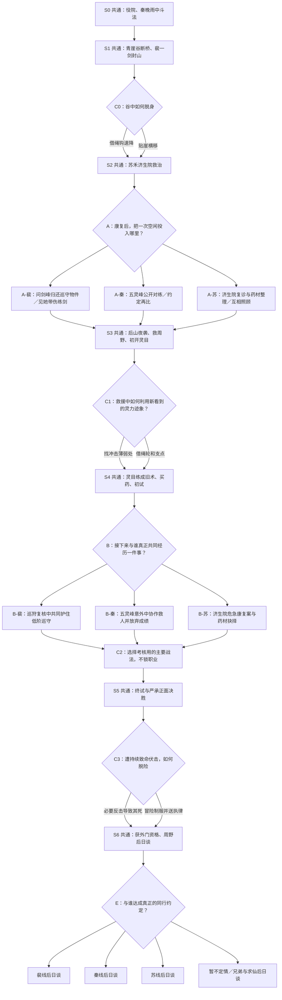

# 《见仙·山门》故事与互动蓝图（当前候选）

**状态：第一部剧情工作稿，仍待审核。** 男主所在宗门正式定名**重明宗**，本身承载一条共同根本法脉；门内设主峰与**七座专业峰**，专业峰不是七条大道。三位重点首座**顾停舟、贺明筠、孟怀真**姓名已确认。 已确认的人物名称、修炼体系和古仙渊源继续有效；裴照雪是**剑脉核心真传**，受镇山堂安排轮值青崖谷一带的封禁巡狩。这属于宗门身份和任务安排，不新增修炼境界。严承、青崖谷事件、夜袭机制和生死分支仍是候选剧情。

## 一、故事主干

陆寻作为**重明宗杂役弟子**靠工分积攒外门选拔所需物资，与周野过着辛苦却有奔头的日子。他在公开斗法场见秦晚以精巧火术取胜，第一次与这位红衣少女交谈；随后严承为夺赤纹芝，暗中用引兽符把妖兽引向这两个杂役，割断吊桥弃他们于死地。两人死里逃生，在青崖谷出口被一名白衣女子持剑拦下——她竟不是阻挠救人的敌人，而是奉命巡狩封禁边界的**内门核心弟子裴照雪**。

后来重明宗后山封苑遭未知外敌夜袭，陆寻为了救濒死的周野，意外与古仙遗目建立初步联系。他在药庐苏禾、同届火行术修秦晚及裴照雪若干真实交集中逐渐学会用观法改善修行，赢得外门资格，公开击败严承。严承因旧事可能暴露而再度下杀手，引出反杀／制服的阶段生死选择。陆寻进入外门，关系与前途都迈入新阶段。

**故事承诺：**青崖谷先有险死互护与惊艳相遇；中段连续得到练成旧术、挣到药钱和公开获胜的实际回报；终段正面翻身、解决严承的现实威胁。主角仍不参与高阶禁库调查。

## 二、连续故事（十一个关键阶段）

### 1｜重明宗山下役院的早晨

陆寻、周野作为记名弟子在山下役院搬演武器具，仰望少数修为扎实的正式弟子御器越过山阶。工分用来买药散、练习护具，公开外门报名依已公布的修炼条件开放，不靠工分购买「试训资格」。苏禾是两人在**百草峰丹脉·济生院**的老熟人，仍是记名弟子，但有医药定向学徒的实际培养机会。午后陆寻到山腰**云阶坪**的公开演武场搬运练习器具，恰好看见同届候选的斗法；他尚不认识秦晚，也不知道裴照雪的名字。**回报：**完成额外差事，攒到一件护具的钱，也看清修炼条件的差距。

### 2｜雨中一线火：秦晚的惊艳初登场

记名弟子中已登记参加秋季外门选拔的候选者在**云阶坪**公开演武场正常对练，护场执事在场，击中制式试比牌或令对手认输即判胜。陆寻因为搬运器具，站在台侧观看。这不是专门为男女主相识而设置的双人考试。

细雨落在石台。对手竖起土行屏障，挡住正面攻击。绛红衣少女没有以更大火球硬撞，而把火焰收为细细一线，借步法绕开土障正面。对手急着转身，防御露出空隙，她以火线击中对手腰间的**试比牌**，在伤及人身前主动收束火势。

台上余焰映亮她的眉眼，陆寻第一次真正看清她的脸。人群为胜者叫好。

**秦晚：**「你也报了外门？」

**陆寻：**「报了。」

**秦晚：**「刚才哪一招最厉害？」

**陆寻：**「最后那下。你本来能烧到人，却改打了牌。」

**秦晚：**「赢了就够了。非要伤人才算厉害吗？」

陆寻说：「下次未必输给你。」

她回头一笑：「好啊。我记住你了。」

**初见回报：**美貌、技术和出手分寸一起建立吸引，而不是自带好感。秦晚在五灵峰预修火术、兼学朱箓峰基础符箓，来自懂一些火术和符箓的普通修炼家庭，乐于竞争，也想摆脱只靠家里条件的评价。五灵峰首座**贺明筠（暂名）**看中她的控火潜力，却要求她在不同场地重复证明稳定性，秦晚有自己的修炼压力。雨中施火需要维持额外控制，胜利来自判断与精细术法。陆寻此时尚未开目，只能观察显而易见的收火行为。

**再次见面：**青崖谷的伤让陆寻离开练场一段时间，恢复后两人因同届公开训练再次遭遇；秦晚辅修符箓，后来能识别引兽符灰的可能类别，但不能凭此认定施术者。

### 3｜山外采集区·青崖谷断桥

严承作为一次低阶采药差事的临时领队，有有限分路和记收获权限。他发现被妖兽守护的赤纹芝，擅用引兽符把妖兽引向陆寻、周野所在的合法采集路线，自己夺芝。陆寻被兽爪伤及手臂与肋侧；周野回身护他，肩背受伤。

严承先过桥，再割断绳索，阻挡妖兽也把尚未过桥的二人留在危险一侧。他事后可声称为护其他人被迫断桥，但玩家通过他**提前放置引兽符、亲眼看见两人尚未过桥仍断绳**的镜头知道其蓄意。陆寻与周野靠日常搬运的绳钩和侧崖攀出，已经赢回一次性命，却仍有妖兽循药篓上的引兽气息追来。

### 4｜青崖谷·一剑封山（裴照雪的真正初登场）

**场景因果：**青崖谷出口连接宗门外围的封禁通道。近期外围兽踪异常，宗门安排内门核心弟子轮值巡狩，裴照雪带领两名外门巡守弟子按固定路线抵达山口。她不是路过救场，职责是**发现并隔绝可能把兽潮和异常物带回山门的风险**。

黄昏。陆寻半背半扶周野来到谷口。周野背上的血沿衣摆滴下，前方是药庐方向的山路。突然，一道白色剑光落在路中央。白衣女子背光持剑，神情冷静。

**裴照雪：**「站住。背篓留下。」

**陆寻：**「我兄弟快撑不住了！求你让路！」

裴照雪没有立即回答，而是看向药篓背带与山谷中不断逼近的兽影。

**陆寻：**「灵草都是照差事采的！不是偷来的！」

她的剑光忽然一闪。陆寻只觉肩后一轻：沾有暗红符灰的外绳被整齐斩断，带着药篓落到路边。裴照雪没有伤他。

**裴照雪：**「追来的不是你们，是那上面的气息。」

她对身后巡守弟子下令：「送伤者去药庐，立刻请医修。封存药篓外绳，记录谷口兽踪。」

两名巡守弟子上前接住周野；陆寻跟着他们离开，临走回头，看见女子一剑划出清亮剑幕，把从侧径追到谷口的妖兽截在界碑外。她能挡住这些妖兽，但必须守住通向山门的狭窄路口，不会为了追究严承擅离巡守岗位。

**陆寻：**「你叫什么名字？」

剑幕后的她没有回答，只说：「带他活下去。」

**这一段的反差：**她先剑指主角、像是拦路的高位者，下一瞬间亲自截断追踪、优先送医并留守山口。**陆寻没有被替代救援：兄弟先靠自己逃出断桥绝境，裴负责截住继续追来的危险。**

裴照雪的巡守报告只证明现场药篓带有异常引兽痕迹，**不能直接判断是谁布下的符**。外绳由巡守封存，清理后的破药篓后来按登记返还陆寻，形成后续秦晚发现内层残符的证据衔接。

### 5｜百草谷药庐的两张病榻

苏禾与陆寻、周野原本熟识；此时她作为百草峰济生院学徒按药庐职责请正式医修处理伤势，自己辅助清创、复诊和药材记录。两人不因有裴照雪救场就立刻痊愈。严承试图让他们接受「擅自改道」的事故认责；陆寻拒签，并依规定向执事说明割桥经过。巡守报告确认了引兽气息，足以启动核验，但暂不能锁定严承预谋害人。

百草峰丹脉首座**孟怀真（暂名）**要求正式医修先处理性命危险，苏禾按学徒权限辅助。事后苏禾想用自己有限的药份帮周野，孟怀真却要她先弄明白药性与伤情，不能凭好心乱给。**回报：**兄弟活下来、守住正式异议；苏禾看见他们真正的脆弱，也开始认真争取独立处理更多康复事务的资格。她不是偶然治病的 NPC，还有自己的药修培养目标。

### 6｜剑会再见：她竟是内门核心

几日后，陆寻伤势允许低强度活动，替外门剑会搬器具、旁听一场面向候选弟子的公开讲剑。内门核心弟子为宗门巡狩和高阶任务轮值，也会在特定公开剑会上示范基础剑理；**并不是每天到杂役院义务授课**。

主持者介绍：「今日示剑，内门核心弟子裴照雪。」

白衣女子登台，一剑将演武台上的制式剑靶连环击退，剑光收束得干净利落。陆寻认出她就是谷口拦路的人，终于知道她的名字；同时发现她右腕旧伤的绷带在运剑后隐约透出血色。**旧伤是她此前巡界任务留下的，青崖谷守口使之牵动，并非一头低阶妖兽突然打败内门核心。**

问剑峰首座**顾停舟（暂名）**注意到裴照雪持剑腕旧伤牵动，认可她守护谷口，却提醒她不可一直带伤硬练。剑会结束时，陆寻在搬剑架。裴照雪经过，认出他，先问：「你兄弟活下来了？」

陆寻点头。她没有邀约吃饭，只道：「那就好。剑别学得太急，旧伤会跟你一辈子。」

**第二次反差：**白天的她是众人仰望的内门核心，陆寻却见过她为守山口承担风险，也知道她并非毫发无损。她最初关注的是陆寻负伤仍背着周野求救的行动，而不是神秘眼睛。

### 7｜后山夜袭与开目

经过康复，陆寻和周野为补药费在**重明宗后山封苑之外的合法卸货台**接差事；两人无权进入封存禁库。未知外敌突袭宗门封库，守卫迎战，冲击波及卸货台。周野把陆寻推开，自己却被断梁压在险处，伤势危及生命。

陆寻没有越级战斗能力，用熟悉的滑轮、绳索与地形救人；封物受损时他偶然观察到真实灵力变化，勉强抓住一次安全窗口拖出周野，随即昏厥。医修赶来后周野才脱险。**初次观法的连接过程仍待机制验证**，不能用“天命选中好人”敷衍。宗门调查夜袭，陆寻不查案。

### 8｜观法练成旧术、挣到药钱

陆寻开始看见自己基础吐纳的实际失误，几日反复练习后终于稳定动作。在药庐，苏禾需要工役配合调试一批低阶暖药器具；陆寻凭熟悉装卸和观法观察到的一处异常完成简单调整，经正式药修验收拿到工分，买到过去舍不得买的恢复药散。**能力改变实际生活，而非凭空升级。**

### 9｜外门初试、人物深入路线与旧案回潮

陆寻通过初试、赢得进一步训练资格。**秦晚**与他在雨中斗法时已见过，青崖谷的伤让他暂时缺席练场；恢复后两人同届对练，秦晚仍占优，但陆寻靠反复练习逐渐能跟上她的火术节奏，两人也开始有实际配合。秦晚兼学符箓，注意到返还的破药篓内层残留符灰可能属于引兽类符片，仍不能认定施术者；材料交宗门执律核验，裴照雪的谷口巡守报告提供时间与现场参照。

玩家可重点与苏禾研究调息与药课、与秦晚训练火术应对和制式符片配合，或在初试后取得一次公开问剑资格，向**裴照雪**请教剑术。**这三个重点相处机会不是终身职业锁**：陆寻入外门后仍可按真正的师承资格申请主修分脉，亲密关系与正式专业培养分开记录。裴不会每天替杂役单独教学；陆寻依靠公开资格和自己的练习，才获得一次较深入的试剑机会。**他从观察她出剑最基础的换步承力开始，不能靠初期开目看穿内门核心的完整高阶剑法**。她认可的是他真正练出来的变化。

### 10｜终试：击败严承；狭路：自卫反击

严承担心青崖谷事故重查，又在外门终试正面输给陆寻。**公开胜利兑现地位逆转**；若他随后于偏僻山路主动以致命术法灭口，陆寻则需在真实杀机下自保，可选择在无法安全脱战时反杀，或冒险制服交执律。宗门依现场和先前证据调查，不因男主身份自动偏袒。两次对抗性质不同，严承未必与夜袭外敌有关。

### 11｜搬离杂役院，分别与未来

陆寻进入外门，能逐步偿还周野的帮助；苏禾争得百草峰安排的山外医修轮修机会，秦晚继续在五灵峰修炼火术、朱箓峰兼修符箓，裴照雪继续在剑脉修行，轮值镇山堂巡守任务。

**裴线的第一部关系回报**不是“核心弟子迅速爱上杂役”，而是她从谷口把他当伤者，到剑会记住他，再到后续正式问剑时认真收剑：「陆寻，你这一次，是用自己的剑了。」若玩家与她深入相处，她可以主动留下下次公开切磋的约定；仍保持身份距离，为后续并肩与真正亲密留空间。

苏禾可有告别或错过；秦晚可在当初的雨中演武台与陆寻主动约战，回收两人第一次交谈的约定；周野的账簿与两座院子形成兄弟情结尾。外部未知势力对禁物的企图留作长线悬念。

## 三、裴照雪的身份、反差与关系链

| 阶段 | 陆寻眼中的她 | 发生的真实变化 |
| --- | --- | --- |
| **谷口初见** | 剑指自己、身份未知的冷面白衣女子 | 她先守职责又保人命，陆寻由愤怒转为震动和感激 |
| **剑会二见** | 万众瞩目的内门核心弟子；有无法忽略的实力差 | 他认出她带旧伤仍出剑，发现「强者也有负担」 |
| **初试后问剑** | 曾经只能仰望的人 | 陆寻自己挣到请教资格，以真实技艺让她产生兴趣 |
| **后续历练** | 可能并肩的同行者 | 两人在真正的共同难题里彼此帮助，才可能产生深入情感 |

**身份约束：**“内门核心”是门内资源、地位与职务，不是新的修炼境界；巡狩由核心弟子轮值带队，范围包括封禁边界与近期风险点，日常普通巡逻仍可由外门巡守承担。裴有管辖巡守现场的权限，不直接审判严承，也不是每场需要救人的时候都凭空出现。

## 四、秦晚的惊艳与关系链

| 阶段 | 观众看到什么 | 与陆寻的变化 |
| --- | --- | --- |
| **雨中斗法** | 红衣少女以细火绕过土障，准确击牌后收手 | 陆寻惊艳于她的容貌、实力与分寸，留下同届较量的约定 |
| **青崖谷之后** | 她仍为外门勤练术法，发现那个不服输的杂役久未出现 | 再遇时开始了解他遭遇了什么 |
| **开目之后** | 她依然领先，却开始需要认真调整打法 | 陆寻凭训练理解更多火术时机，二人逐渐可以合作 |
| **外门之后** | 她继续自己的修行，不是只围着男主转 | 可以赴当年练场的新约，发展出竞争、信任与暧昧 |

三位女主的初见必须不同：**裴照雪生死一剑与身份差，苏禾旧识陪伴与可能分别，秦晚雨中火术与同龄竞争。** 秦晚主修火行术法、兼学符箓，不另造机械式双人考试。

## 五、互动回报（仍只保留三个主要选择）

1. **更深入与谁训练：**苏禾药课与调息／秦晚五行火术对练与基础符箓合作／裴照雪初试后的正式问剑。三条路线都必须有一次训练的小胜、特别相处和终试的对应技巧；其余两位继续正常修行。
2. **告诉周野多少灵目异常：**部分坦白或暂时保留，改变彼此承担秘密的方式与搬院的谈话，不人为制造兄弟背叛。
3. **严承致命伏击时如何自保：**必要反杀或冒险制服，改变伤势、严承去向和后续官方处理。所有完成充分修炼的路径都能参与外门晋升。

## 六、拍摄与逻辑验证清单

- **青崖谷空间：**严承先过吊桥→主动断桥→陆寻周野借侧崖逃出→妖兽循药篓残味绕侧径追来→巡狩小队固定巡视谷口。不能用裴的横空出现替代他们自己的逃生。
- **巡守分工：**裴负责隔绝谷口危险，两名随行巡守接人送医。她的剑可以精准断开引兽物，但无法从残留气息凭空辨认施术者；报告要成为后续执事调查可用的有限事实。
- **强弱关系：**裴对谷口妖兽有明显压制，不把她写成被低阶妖兽打得濒死；旧伤因承担额外巡守任务而牵动，来源于此前别的险务。
- **后续再见：**问剑峰的公开剑会允许旁听，深入问剑需初试资格；秦晚首次雨中公开斗法在青崖谷之前，恢复后的再会在其后，不能写成首次相遇；苏禾作为旧识不需要重写偶遇。
- **其余待定：**夜袭与遗目接入机制；严承的引兽与断桥证据；外门选拔名额和赛制；旧伤到底为何留下。以上均属剧情候选，不能当作已确认的修炼规则。

**下一步建议：**分别将秦晚《雨中一线火》和裴照雪《一剑封山》制作成可审核分场，再核对青崖谷伤情与初试、旧案符灰的时间线。
## 七、Steam 影视互动的分支结构 v0.1（待审）

**本节为拟议互动设计，尚不是剧情定稿。** 本作是 AI 生成影视画面为主体、陆寻单一玩家视角的 Steam 游戏。采用**固定修仙主线＋两轮女主专属事件＋短战斗分歧＋模块化结局**，而不是为每位女主拍摄从头到尾彼此不同的整部电影。

### 7.1 先分清四种选择的作用

| 选择类型 | 例子 | 立刻可见的回报 | 对长期故事的影响 | 预算原则 |
| --- | --- | --- | --- | --- |
| **情绪回应／微选择** | 青崖谷受伤后如何回应周野或苏禾 | 5—20秒不同表情或对白 | 记录人物曾怎么对待彼此，可在后续短句中回调 | 同景别插镜，立即汇合 |
| **局部行动／战斗** | 夜袭时从哪条安全路径救周野、终试用何种策略 | 不同动作、少量受伤／资源消耗／观法疲劳 | 改变后续一句对白、恢复代价或下一战可用手段 | 20—90秒独有镜头后汇合 |
| **女主专属事件** | 去问剑峰、五灵峰或百草峰帮助一位姑娘解决她自己的难题 | 5—8分钟**真正不同**的共同经历和情感事件 | 影响亲密信任、约定、下一段独占相处和结尾 | 每轮三条支线，但回到共同主事件 |
| **命运与结局** | 选择谁为长期同行者；严承伏击时如何保命 | 明确不同的短结局和未来约定 | 带往后续篇章的关系状态、伤势与道德代价 | 片段模块拼接，不把3×2拍成6部电影 |

**核心纪律：**每个重要选项都要有“玩家为何选择、可见收益、具体代价、何时汇合、以后在哪回收”。不允许选择看起来不同却只暗地里+1好感，不允许任何一个女主路线的独有技能成为通关主线必需品。

### 7.2 第一部应该采用的结构

**顺序逻辑：**三女主初见必须在主要情感分支前都完成；A是初步了解，可以随意选择；B是主动加深关系，也可与A选择不同的人，但没有第一轮私下交集的人需要补一小段相识桥接，不能突然已是恋人。A、B各自独有剧情结束后必须汇合到共通危机。E明确让玩家选择是否定情，而不是暗中以几个好感数字剥夺意愿。

### 7.3 两轮女主事件的核心内容

| 对象 | A轮：值得亲近她的一个小故事（约4—5分钟） | B轮：能建立深层关系的一场事件（约7—8分钟） | 独有情感回报 |
| --- | --- | --- | --- |
| **裴照雪** | 陆寻因正式器具差事到问剑峰归还巡守用品，发现裴带旧伤练剑，顾停舟要求她停手。她看见陆寻努力按规矩还物，两人有一次短暂但认真交谈。此时她仍高不可攀 | 初试后陆寻获得合法低阶巡守辅助差事（不进入禁区），裴带队复核夜袭后外围失效的警戒物；一名低阶巡守遇险，裴与陆寻各尽自身能力把人救回。她首次主动询问陆寻的具体判断 | 由被她救命的杂役，到她愿意承认的同行者；不是直接获得剑脉秘传 |
| **秦晚** | 陆寻在五灵峰合法公开练习与她再次较量；她先赢，后来发现他复伤仍坚持认真练习；她不是因为家学高就没有训练压力 | 一次五灵峰普通实战训练发生低阶灵火失控（原因需要具体设计）；秦晚在保住个人成绩和帮助受困同届之间主动选择先救人，陆寻以自己已经练成的能力配合。两人吃到代价，又共同争回一次练习机会 | 从“想赢过你”，变成“危险时我愿意与你并肩”；仍保留明艳、争强、主动邀约 |
| **苏禾** | 伤后复诊、帮忙整理药材和病案。她不是免费给陆寻送药，而是让陆寻看见医修学徒也要花很多时间练出基本诊药能力 | 济生院重伤同门恢复异常，一批低阶暖药器具被怀疑失效。苏禾凭真实药理提出初步判断，陆寻凭工役经验与初期观法提供可验证的器具数据，由正式医修作临床决定。她承担学徒考核压力，两人共同纠正错误并获得报酬／认可 | 从熟悉的照顾，到陆寻也能成为她可信赖的支持者；她的未来轮修和可能离山产生真实分离感 |

**A、B并不要求“同一地点三选一强迫凑队”。** 它们是主角有限休息时间、合法公开训练及获得初试资格后所能争取的三种不同机会。尤其裴是内门核心、苏禾是学徒，必须遵守各自身份和职责，不能全部陪杂役随意闯禁区。

**制作注意：**共通节点中三人都持续露面；没有选某位女主，她仍然参加自己原本的修炼、巡狩或药修培养，不因此消失。B轮选谁是关系重心，不强制绑定陆寻的正式主修专业或最终的道侣身份。

### 7.4 战斗与灵目：选的是战术，而不只是正误题

**青崖谷（C0）：**严承断桥、周野与陆寻互救是固定因果。玩家选“借绳钩速降”或“贴崖横移”，分别影响携回合法药材的数量与手臂伤情，二人都必须凭已有技能逃到谷口，并保有可供后续核对的现场线索。不可因“没选救兄弟”就凭空让周野死，也不可让裴代替主角脱困。

**夜袭（C1）：**周野推开陆寻、自己濒危，陆寻初次看到灵力变化是必经事件。可选“观察冲击中断点”或“先按平时搬运经验借绳轮卸力”；前者提高当次观法负担、减少拖拽伤，后者更伤身体、保留短暂清明。两种都需实际医修救人，后续可在药庐和兄弟谈话回收。**没选择灵目仍会觉醒**，只是第一次怎样使用不同；灵目不会自动治伤或读懂古史。

**终试（C2／S5）：**把“学到了什么战法”和“喜欢谁”分开。玩家可在公共训练和已获资格的专修中学会基础步法时机、五行术法应对、稳定调息等；选择哪种方法与A/B女主焦点独立。战斗中面对严承，合理的选项应为“守住发力窗口、诱其改变出招、稳气拖过爆发”这类明确策略。优选战术有短动作镜头，错误预判会造成受伤、消耗或丢失奖励，不允许凭错误选项也获得完全相同的无伤神胜。**主线最终晋升仍需满足真实训练与考核表现**，不靠女主好感免费通关。必要时严重失误进入短失败结局并从最近战斗检查点重试，不迫使玩家重刷整部剧情。

**伏击（C3）：**严承在考核落败后继续主动使用致命攻击。玩家选择尝试安全脱战并制服，或在无法退出且对方持续攻击时作必要致命反击；真实结果要由场景中的攻击距离、身体状况和可退路线决定，**不是敌人已投降后弹“杀／不杀”按钮**。两条有不同伤势、物证和执律处理镜头，结尾均回到陆寻进入外门，严承是否死亡作为独立结果存档。

### 7.5 极简状态，不做 RPG 数值迷宫

| 状态字段 | 初版设计 | 如何在场景中使用 |
| --- | --- | --- |
| `firstBond` | `pei/qin/su` | 第一轮陪伴记录，只触发约10—20秒的熟识对白 |
| `focus` | `pei/qin/su/none` | 第二轮主要同行对象，决定专属事件和结尾深入资格 |
| `training` | `timing/control/steady` | 独立的战斗打法成长；不等于恋爱路线、不等于终身职业 |
| `broTrust` | `open/reserved` | 透露灵目异常的程度；只影响兄弟谈话和配合准备，不制造无故背叛 |
| `injury` | `light/heavy` | 战斗小伤、医药消耗及末尾角色关心镜头 |
| `evidence` | `basic/strong` | 巡守记录和残符证据完整度，影响追究严承的顺利程度 |
| `yanOutcome` | `dead/captured` | 最后伏击后果和独立短后日谈模块 |
| `endingCompanion` | `pei/qin/su/solo` | 玩家明确约定谁同行，或选择继续独自修炼 |

**可制作约束：**不要预拍所有`focus × training × yanOutcome`组合。共享大场景按事件统一制作，女主事件按focus调度，战斗只拍战术特写和因果反应，结尾把关系模块与严承后果模块分开播放。缺少早期专属情感铺垫时，可以只达成“相约下一次同行”，不自动确立深恋。

### 7.6 制作预算示例：不是已验证的成本预测

以下是为了验算分支爆炸的**原创假设**（分钟指单个玩家观看或全版本去重后的影视时长，不等于一次视频生成可稳定获得的最终素材）。

| 内容 | 全版本需制作的不同影视分钟 | 单条典型通关看到 |
| --- | ---: | ---: |
| 共通主线：役院→青崖谷→夜袭→修炼→终试→晋升 | 约65 | 约65 |
| 女主A轮与B轮：每位5＋8分钟，共三位 | 约39 | 约13 |
| 女主结尾：三位各5分钟，另有独行约4分钟 | 约19 | 约4—5 |
| 战斗差异动作、死亡／制服等候选变化 | 约12 | 约4—5 |
| 条件反馈和不同关系对白短镜头 | 约5 | 约1 |
| **总计** | **约140分钟** | **约87—89分钟** |

这只是**分支设计的预算模型**，不是市场公认合理时长，也不是 AI 生成视频的报价。正式估算必须把镜头切为8—20秒级别的可生成单元，并验证人物一致性、动作连续性、嘴型与空间匹配。**不应只看分钟数，还要统计高难动作镜头和人物多次同框的重做风险。**

### 7.7 下一轮先交付什么

1. **先试玩前两次选择：**青崖谷逃生的两个短变体，随后苏禾救治；确认没有“换个选项主线仍一模一样”的欺骗感。
2. **先做一条完整女主闭环：**优先采用秦晚（雨中初见→A轮对练→B轮救人→终试打法兑现→结尾相约），写到可以按节点播放并通关；裴／苏使用相同节点框架但讲不同事件，不照搬秦晚台词。
3. **最后验证镜头量：**以“共通镜头60%以上、每位女主两段独有事件和一段结尾、战斗支线快速汇合”为初始制作目标；若三位路线共用同一关键情感镜头过多，宁可压缩数量也不能降低人物真实差异。

